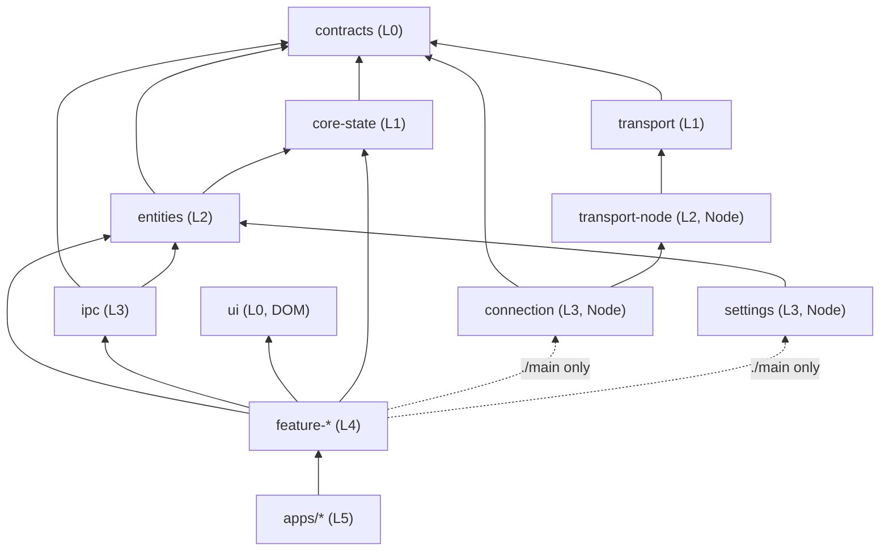

# Clients architecture: TypeScript package graph

This document owns the structure of the TypeScript clients under `clients/`: which packages exist,
which way they may depend on each other, what each entry point may use from its runtime, and how
the workspace builds, checks, and tests them. It is the design of record. Packages that do not
exist yet are marked in the [migration status](#migration-status) table, with the item that
creates each one.

It builds on, and does not restate:

- [`architecture.md`](architecture.md): the Python module graph and the placement rule. The same
  principles (deep modules, one-way dependencies, a pure core with a thin shell) apply here.
- [`desktop-connection.md`](desktop-connection.md): what the desktop main process, the host helper,
  and the screen stores do. This document says which package each of those lives in.
- [`wire-protocol.md`](wire-protocol.md): the run protocol that `@vibesys/contracts` types.
- [`web-development.md`](web-development.md): how to run the web UI and the desktop app.

`clients/tui` is deprecated. It keeps building and its checks stay green, but it is not migrated
into this graph; it consumes the packages below through their public entry points like any other
app, and is deleted when the desktop app replaces it.

## Why

`clients/web` and `clients/desktop` grew as two large packages with layering rules enforced inside
each (`state/` pure, `ui/` free of I/O, `effects/` never importing `ui/`). Those rules hold inside a
package but say nothing about which feature may reach which, or which runtime a module may use.
A feature that imports another feature's internals, or renderer code that imports a Node module,
type-checks today and is caught, if at all, by review.

The fix is the same one the Python side uses with `tach`: make every boundary a package boundary,
declare the edges, and let tooling refuse the rest. A package is used only through its `exports`
map; each entry point is compiled with exactly the runtime library it may use; and one checker
validates the graph from the manifests. Per-feature packages make each feature small enough to
read whole, and the build model below keeps a graph of thirty packages as fast as the current five.

## The package graph

```text
clients/
  contracts/        @vibesys/contracts        generated message types + the one runtime validator
  ui/               @vibesys/ui               domain-free React primitives + design tokens
  core-state/       @vibesys/core-state       pure fold of run events            -> contracts
  transport/        @vibesys/transport        framing, redial, persistent stream -> contracts
  entities/         @vibesys/entities         run/host/task models + selectors   -> contracts, core-state
  transport-node/   @vibesys/transport-node   stdio / unix socket / ssh channel  -> transport
  ipc/              @vibesys/ipc              typed main <-> renderer messages   -> contracts, entities
  connection/       @vibesys/connection       host connection manager            -> contracts, transport-node
  settings/         @vibesys/settings         settings store, atomic files       -> entities
  features/<x>/     @vibesys/feature-<x>      run-view, connect-host, start-run, stop-run,
                                              resume-run, recent-runs, path-autocomplete
  apps/desktop-main      @vibesys/app-desktop-main      composition only (Electron main)
  apps/desktop-renderer  @vibesys/app-desktop-renderer  composition only (Electron renderer)
  apps/web               @vibesys/app-web               composition only (browser)
```



### Layers

Every package declares its layer in `package.json` (`"vibesys": {"layer": ...}`). A package may
depend only on packages in a strictly lower layer. That one rule gives the direction, rules out
cycles, and forbids feature-to-feature and app-to-app edges, because peers share a layer.

| Layer | Rank | Packages | May depend on |
| --- | --- | --- | --- |
| `foundation` | 0 | `contracts`, `ui` | nothing in the workspace |
| `core` | 1 | `core-state`, `transport` | foundation |
| `domain` | 2 | `entities`, `transport-node` | foundation, core |
| `service` | 3 | `ipc`, `connection`, `settings` | foundation, core, domain |
| `feature` | 4 | `feature-*` | anything below |
| `app` | 5 | `apps/*` (and the legacy `desktop`, `web`, `tui`) | anything below |

This refines the sketch in the brief in two places. `ui` sits in `foundation`, not beside
`entities`: rank 0 is the mechanical form of "no domain dependencies", so the layer rule enforces
rule 6 for `ui` with no special case. `transport-node`, `connection`, and `settings` get ranks of
their own (`domain` and `service`) because each depends on another package the sketch places at
the same level (`connection` on `transport-node`, `settings` on `entities`, `ipc` on `entities`).

### Entry points and runtimes

Every entry in a package's `exports` map declares the runtime it may use, in the same
`"vibesys"` block:

| Runtime | Compiler `lib` | Compiler `types` | Who may import it |
| --- | --- | --- | --- |
| `neutral` | `ES2022` | none | any entry |
| `dom` | `ES2022`, `DOM`, `DOM.Iterable` | none (`vite/client` for apps) | `dom` entries |
| `node` | `ES2022` | `node` (and `electron` where needed) | `node` entries |

An entry may import an entry of another package only when the target is `neutral` or has the same
runtime. A feature package has up to three entries:

- `./state` (`neutral`): the pure reducer, selectors, and the interfaces its effects need (for
  example `RunControl`). No React, no I/O.
- `./renderer` (`dom`): state plus `ui/` components plus `effects/`, which call the injected
  interfaces. It depends on `@vibesys/ui`, never on a platform package.
- `./main` (`node`): the main-process controller that implements the interfaces with
  `@vibesys/connection`, `@vibesys/settings`, and `@vibesys/transport-node`.

Node-only packages (`transport-node`, `connection`, `settings`) therefore reach the renderer
through no path: only `node` entries may import them, and only `desktop-main` and features'
`./main` entries are `node`.

### Rules and what enforces them

| # | Rule | Enforced by |
| --- | --- | --- |
| 1 | Layer direction; Node-only packages reachable only from `node` entries | `scripts/check_package_graph.mjs` (manifests and imports) |
| 2 | No feature depends on another feature; cross-feature flows are composed in apps | `check_package_graph.mjs` (peers share a layer) |
| 3 | A package is used only through its `exports` map; every import of a workspace package is a declared dependency | `check_package_graph.mjs`, Biome, and `.dependency-cruiser.mjs` for third-party imports |
| 4 | Each entry is compiled with the `lib` and `types` of its runtime, so importing a Node module from a renderer entry is a type error | one composite `tsconfig.<entry>.json` per entry, checked by `check_package_graph.mjs`; `tsc -b` enforces it |
| 5 | Inside a package: `state/` pure, `ui/` free of I/O, `effects/` never import `ui/`, effects depend on injected interfaces | `lint-rules/*.grit` (Biome) and `.dependency-cruiser.mjs` |
| 6 | `@vibesys/ui` has no domain dependencies; helpers live in the lowest package that needs them, with no shared junk drawer | the layer rule (`ui` is rank 0); review |

The package-graph rules live in one checker. `.dependency-cruiser.mjs` keeps only the rules about
modules inside a package and about third-party imports.

## Build model

The workspace stays fast as the package count grows because nothing waits on a build it does not
need, and nothing repeats work whose inputs did not change.

**Source condition.** Every export carries a custom condition that points at its TypeScript source:

```json
"exports": {
  "./state": {
    "@vibesys/source": "./src/state/index.ts",
    "types": "./dist/state/index.d.ts",
    "default": "./dist/state/index.js"
  }
}
```

Vite (`resolve.conditions`), the Bun test runner (`--conditions`), and `tsc`
(`customConditions` in `clients/tsconfig.base.json`) all resolve that condition, so the dev
server, tests, and type checks read dependencies from source and never need a prebuilt `dist/`.
Node and Electron at runtime do not set the condition and load `dist/`. There are no `paths`
aliases and no `pre*` "build dependencies first" scripts.

**Project references.** Each entry is a `composite`, `incremental` TypeScript project; the
package's `tsconfig.json` is a solution file that references its entry projects and its test
project, and each entry project references the entry projects of the packages it imports.
`tsc -b` then type-checks and emits declarations per project, skipping every project whose inputs
are unchanged, and checks a dependent against its dependencies' declarations instead of their
source.

**Task runner.** [Turborepo](https://turborepo.com) runs `build`, `check`, and `test` across the
workspace in dependency order, in parallel, with a content-hash cache in `clients/.turbo/cache`.
A task whose inputs (the package's tracked files, its dependencies' hashes, and the shared
configuration) match a previous run replays its output instead of running. `test` depends on a
`transit` task rather than on `^build`, so tests start at once while still being invalidated
when a dependency's source changes. Turborepo was chosen over Nx because it needs one
`turbo.json` and the existing `package.json` scripts, with no plugins, generators, or project
files per package; Nx's extra capabilities (code generators, module-boundary lint) are covered
here by the scaffold and the graph checker.

| Command (from `clients/`) | What it runs |
| --- | --- |
| `pnpm check:clients` | `turbo run check`: `tsc -b` in every package |
| `pnpm test:clients` | the script tests, then `turbo run test` |
| `pnpm build:clients` | `turbo run build` |
| `pnpm turbo run test --filter @vibesys/<package>` | one package, building only what it needs |

## Adding a package

```bash
cd clients
pnpm new:package <layer> <name>      # e.g. pnpm new:package domain entities
pnpm new:package feature <name>      # e.g. pnpm new:package feature stop-run
pnpm install
```

The scaffold writes the manifest (name, layer, `exports` with the source condition, entry
runtimes, scripts), one `tsconfig.<entry>.json` per entry with its runtime's `lib` and `types`, the
test project, a passing smoke test, and the Knip policy, so the new package passes every check on
its first commit. Add workspace dependencies with `pnpm add --workspace @vibesys/<dep>` and a
matching project reference; the graph checker names any mismatch.

## Migration status

| Package | Layer | Status | Item that creates or moves it |
| --- | --- | --- | --- |
| `@vibesys/contracts` | foundation | pilot | foundation item (#1869), contracts pilot |
| `@vibesys/ui` | foundation | planned | web feature-folder refactor, then package extraction |
| `@vibesys/core-state` | core | exists (moves to the source condition and project references) | foundation item |
| `@vibesys/transport` | core | planned (split from `backend-client`) | backend-client split |
| `@vibesys/transport-node` | domain | planned (split from `backend-client/node` and desktop's links) | backend-client split |
| `@vibesys/entities` | domain | planned | desktop and web model extraction |
| `@vibesys/ipc` | service | planned (from desktop's bridge and preload messages) | desktop main/renderer split |
| `@vibesys/connection` | service | planned (desktop's connection manager) | desktop main/renderer split |
| `@vibesys/settings` | service | planned (desktop's settings store) | desktop main/renderer split |
| `@vibesys/feature-*` | feature | planned: run-view, connect-host, start-run, stop-run, resume-run, recent-runs, path-autocomplete | feature extraction, after the web feature-folder refactor lands |
| `apps/desktop-main`, `apps/desktop-renderer`, `apps/web` | app | planned | app composition, last |
| `@vibesys/backend-client` | foundation until the pilot, then core | exists; split into `transport` and `transport-node`, then deleted | backend-client split |
| `@vibesys/desktop`, `@vibesys/web` | app | exist; emptied into features and apps, then deleted | app composition |
| `@vibesys/tui` | app | deprecated; kept building, not migrated | none |

Roadmap [#1878](https://github.com/uw-syfi/vibesys/issues/1878) tracks this migration; each item gets
a sub-issue there when it starts.
